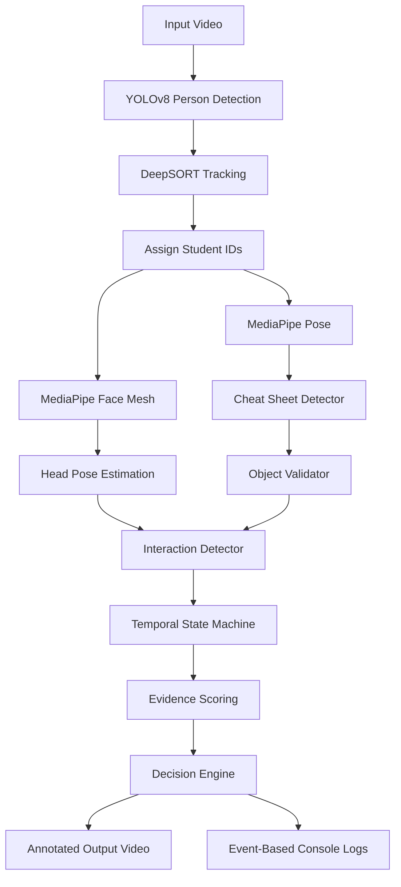

# ExamGuard: An Intelligent Surveillance System for Cheating Detection in Offline Exams

[](https://opensource.org/licenses/MIT)
[](https://www.python.org/downloads/)
[](https://opencv.org/)
[](https://ultralytics.com/)
[](https://google.github.io/mediapipe/)

**ExamGuard** is a state-of-the-art, real-time computer-vision-based surveillance system designed to monitor offline examination environments and automatically detect academic cheating through multi-student tracking, head pose estimation, object change detection, and temporal state machines.

---

## 🚀 Project Overview

Monitoring offline examinations is a complex and resource-intensive challenge. Traditional invigilation suffers from several limitations:
- **Cognitive Fatigue**: Human invigilators struggle to monitor large halls continuously, resulting in missed incidents.
- **Inconsistency**: Invigilation quality varies due to fatigue, distraction, or subjective biases.
- **Intervention Delay**: Actively identifying, documenting, and addressing cheating without disrupting other candidates is difficult.

**ExamGuard** addresses these problems by providing an automated, objective, and real-time surveillance solution. Using advanced machine learning and multi-object tracking, the system continuously analyzes student movements, gaze targets, and desk interactions to verify cheating with structured, explainable evidence—while ensuring that normal student behavior (such as writing or drinking water) does not trigger false alerts.

---

## ✨ Features

- **Multi-Person Tracking & Persistent IDs**: Integrates YOLOv8 human detection with DeepSORT tracking to identify and persistently monitor students even during occlusion.
- **Head & Gaze Pose Estimation**: Implements 3D head pose calculations using MediaPipe Face Mesh and PnP solvers to track where students look (e.g., Forward, Down, Left, Right, Back).
- **Static Paper Change-Detection**: Automatically ignores permanent desks, papers, and answer sheets via one-time calibration to prevent false alarms.
- **Cheat Sheet Detection**: Segments newly appearing white paper slips using HSV thresholding and filters out candidate contours by location, size, and shape.
- **Object Validation & False-Positive Rejection**: Employs structural metrics (extent, aspect ratio) to validate paper slips and exclude bottles or hands near the mouth.
- **Symmetric Interaction Detection**: Dynamically tracks hand proximity and object transfers between adjacent students.
- **Dynamic Context-Aware Proximity**: Uses a strict wrist proximity threshold under normal conditions and automatically expands it during hand approaches to capture stretching movements.
- **Temporal State Machines**: Tracks sequences of activities (pocket reaches, reading, hiding, passing) over time rather than relying on one-off events.
- **Evidence-Based Scoring Engine**: Flags cheating behaviors only after accumulating enough score points, minimizing false alarms.
- **Explainable Console Logs**: Displays clear, event-driven status logs showing precise timestamped transitions and decision rationale.
- **Video Visualization Overlay**: Annotates processed frames with bounding boxes, head direction trackers, and warning banners for passing events.

---

## 🔄 Project Flow

The following diagram illustrates the complete processing pipeline of ExamGuard from video input to cheating classification output:



---

## 🏗️ System Architecture

ExamGuard is built on a highly modular architecture where each component has distinct, isolated responsibilities:

- **`main.py`**: The orchestrator of the system. Loads configuration baselines, reads video frames, runs the YOLOv8 and DeepSORT pipelines, resolves landmarks, manages student state instances, and generates the annotated output video.
- **`baseline_learner.py`**: Handles one-time scene learning using `input_normal.mp4`. Identifies the sizes and coordinates of desk papers, normal writing wrist movement bounds, and gaze profiles.
- **`baseline.json`**: The persistent scene profile file created during calibration. Stores static paper coordinates, pocket proximity thresholds, and normal exam posture bounds.
- **`cheat_sheet_detector.py`**: Segments and detects suspicious white paper sheets inside student crops and applies filters based on size, height limits, and wrist proximity thresholds.
- **`object_validator.py`**: Validates whether a segmented contour is a paper slip based on aspect ratio, fill factor (extent), and bottle-rejection metrics.
- **`cheating_state_machine.py`**: Evaluates individual cheating behaviors through an 8-state transition logic, validating pocket reaches, sustained cheat sheet reading, and hiding actions.
- **`interaction_detector.py`**: Coordinates student pair interactions. Tracks hand approaches, monitors symmetric cheat sheet history, and drives the passing state machine.

---

## 🕵️ Supported Cheating Scenarios

### Scenario 1: Individual Cheat Sheet Usage
Tracks a student fetching, reading, and hiding a cheat sheet.
```text
NORMAL ➔ POCKET_REACH ➔ UNKNOWN_OBJECT_APPEARS ➔ CHEAT_SHEET_HELD ➔ READING_CHEAT_SHEET ➔ CHEAT_SHEET_UNDER_ANSWER_SHEET ➔ RETURN_TO_POCKET ➔ CHEATING_CONFIRMED
```

### Scenario 2: Cheat Sheet Passing Between Two Students
Tracks adjacent students passing a cheat sheet between their hands.
```text
NO_INTERACTION ➔ HAND_APPROACH ➔ OBJECT_IN_TRANSFER ➔ OWNERSHIP_TRANSFER ➔ OBJECT_RECEIVED ➔ PASSING_CONFIRMED
```

> [!NOTE]  
> Both individual and passing detection state machines run in parallel. A student can be flagged for passing interactions without affecting their individual cheating state machine, and vice versa.

---

## 📈 Temporal State Machine

The individual cheating detection sequence is managed via a strict temporal state machine to ensure activities must follow a logical timeline:

```mermaid
stateDiagram-v2
    [*] --> NORMAL
    NORMAL --> POCKET_REACH : Wrist moves to hip
    POCKET_REACH --> UNKNOWN_OBJECT_APPEARS : New white shape near wrist
    UNKNOWN_OBJECT_APPEARS --> CHEAT_SHEET_HELD : Object matches paper metrics
    CHEAT_SHEET_HELD --> READING_CHEAT_SHEET : Student looks down at sheet
    READING_CHEAT_SHEET --> CHEAT_SHEET_UNDER_ANSWER_SHEET : Sheet hidden under desk paper
    CHEAT_SHEET_UNDER_ANSWER_SHEET --> RETURN_TO_POCKET : Hand returns to hip area
    RETURN_TO_POCKET --> CHEATING_CONFIRMED : Hand leaves hip; sheet stowed
```



| State | Description |
| :--- | :--- |
| **`NORMAL`** | The student is sitting and writing the exam normally. |
| **`POCKET_REACH`** | The student's wrist moves to their hip/pocket area and remains there briefly. |
| **`UNKNOWN_OBJECT_APPEARS`** | A new, non-baseline white object is detected near the student's wrist. |
| **`CHEAT_SHEET_HELD`** | The object is validated as a paper-like sheet and moves with the student's hand. |
| **`READING_CHEAT_SHEET`** | The student continuously looks down at the sheet (gaze classified as DOWN). |
| **`CHEAT_SHEET_UNDER_ANSWER_SHEET`** | The sheet disappears beneath the baseline desk paper coordinates while the student continues writing. |
| **`RETURN_TO_POCKET`** | The hand moves back to the pocket/hip region (stowing the sheet). |
| **`CHEATING_CONFIRMED`** | The hand leaves the pocket, and the full temporal cheating sequence is validated. |

---

## 📊 Evidence Scoring

ExamGuard uses a scorecard-based accumulation engine. A student or pair of students is only flagged for cheating once the total score crosses a designated threshold (**$\ge 12$**):

| Behavioral Evidence | Score Weight | Type |
| :--- | :---: | :---: |
| **Pocket Reach Detected** | `+3` | Individual |
| **New Paper slip Detected** | `+4` | Individual |
| **Object Follows Hand Movement** | `+3` | Individual |
| **Student Looking Down at Sheet** | `+3` | Individual |
| **Object Hidden Under Answer Sheet** | `+4` | Individual |
| **Object Returned to Pocket** | `+3` | Individual |
| **Bottle Detected (Bottle Validator)** | `-6` | Mitigation |
| **Hand Near Mouth (Drinking / Coughing)** | `-10` | Mitigation |

---

## 🛡️ False-Positive Reduction Techniques

To ensure ExamGuard does not trigger alerts during normal examination activities, several mitigation strategies are employed:
- **Baseline Calibration**: Reads `input_normal.mp4` to catalog desk papers and normal writing movements before detection starts.
- **Static Paper Filter**: Removes known answer sheets from the tracking pipeline. If a candidate paper contour matches the bounding box of a learned baseline desk paper, it is ignored.
- **Bottle & Cup Rejection**: If an object's hue, saturation, or aspect ratio matches a plastic bottle (learned during calibration), it receives negative evidence weight.
- **Mouth Trajectory Detection**: If wrists move close to the student's nose/mouth region, it is classified as drinking or coughing, applying a `-10` score penalty.
- **Adaptive Thresholding**: Wrist proximity limits are computed dynamically as a fraction of the student's tracked height (`ph`), keeping detection scales invariant.

---

## 💻 Tech Stack

| Domain | Technology | Purpose |
| :--- | :--- | :--- |
| **Language** | Python 3.8+ | Core development language |
| **Computer Vision** | OpenCV | Frame extraction, HSV thresholding, and contour analysis |
| **Object Detection** | YOLOv8 (Ultralytics) | Real-time human bounding box detection |
| **Tracking** | DeepSORT | Persistent ID assignment and tracking across frames |
| **Landmarks** | MediaPipe Face Mesh | 468 face landmarks for head pose PnP estimation |
| **Pose Estimation** | MediaPipe Pose | Wrist, hip, and shoulder tracking |
| **Math & Matrix** | NumPy | Euclidean distance metrics and pose calculations |

---

## 📁 Folder Structure

```text
project/
│
├── baseline_learner.py         # Calibrates scene profiles and writing baselines
├── baseline.json               # Serialized scene baseline configuration
├── cheat_sheet_detector.py     # Segments and detects suspicious white paper sheets
├── cheating_state_machine.py   # Manages individual student state machines and scores
├── interaction_detector.py     # Tracks student interactions and passing state machines
├── object_validator.py         # Validates candidate contours against paper models
├── main.py                     # System orchestrator and visualization engine
├── yolov8n.pt                  # YOLOv8 weight file
├── input.mp4                   # Input video showcasing cheat passing
├── input_normal.mp4            # Input video showing normal writing (calibration)
├── readme.md                   # Project documentation
└── requirements.txt            # Python dependencies
```

---

## ⚙️ Installation

### 1. Clone the Repository
```bash
git clone https://github.com/Sahana-Pixel/offline-exam-cheating-detection.git
cd offline-exam-cheating-detection
```

### 2. Create Virtual Environment
```bash
python -m venv .venv
# On Windows:
.venv\Scripts\activate
# On Linux/macOS:
source .venv/bin/activate
```

### 3. Install Dependencies
```bash
pip install -r requirements.txt
```

---

## 🏃 How to Run

### Phase A: Scene Calibration (One-Time)
Run calibration on the normal writing baseline video to generate `baseline.json`:
```bash
python baseline_learner.py
```

### Phase B: Cheating Detection
Run the detection pipeline on the active test video:
```bash
python main.py
```
*   `input_normal.mp4` is processed to learn normal examination behaviors.
*   `input.mp4` is processed to detect individual and cheat sheet passing violations.
*   The system creates `output_head_pose.mp4` containing visualized overlays.

---

## 📝 Console Output (Explainable AI)

ExamGuard provides clear, explainable logs displaying transition steps and decision rationale:

```text
[00:00.65]
State changed:
Student ID 2
NORMAL → POCKET_REACH
Reason: Pocket reach motion confirmed (wrist moved to hip, dwelled, and left).
----------------------------------------------------

----------------------------------------------------
[00:01.20]
State changed:
Student ID 2
POCKET_REACH → UNKNOWN_OBJECT_APPEARS
Reason: Unknown object appeared near the hand.
----------------------------------------------------

----------------------------------------------------
[00:01.30]
State changed:
Student ID 2
UNKNOWN_OBJECT_APPEARS → CHEAT_SHEET_HELD
Reason: Object validated as paper-like (paper confidence: 0.74).
----------------------------------------------------

----------------------------------------------------
[00:03.80]
State changed:
Student Pair (1, 2)
NO_INTERACTION → HAND_APPROACH
Reason: Students' wrists moved close together.
----------------------------------------------------

----------------------------------------------------
[00:04.15]
State changed:
Student Pair (1, 2)
HAND_APPROACH → OBJECT_IN_TRANSFER
Reason: Cheat sheet detected in the midpoint region between their wrists.
----------------------------------------------------

----------------------------------------------------
[00:04.20]
State changed:
Student Pair (1, 2)
OBJECT_IN_TRANSFER → OWNERSHIP_TRANSFER
Reason: Cheat sheet ownership transferred from Student 1 to Student 2.
----------------------------------------------------

====================================================
🚨 CHEAT SHEET PASSING DETECTED
Student A : 1
Student B : 2

Evidence Summary
✔ Hands approached
✔ Cheat sheet shared
✔ Ownership transferred
✔ Student B received object
✔ Temporal sequence verified

Reason:
Unauthorized transfer of cheat sheet between students.
====================================================
```